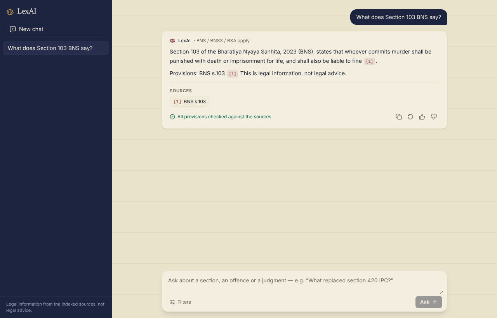

# LexAI — legal research assistant for Indian law

[](https://github.com/allu0786ansari/LexAI/actions/workflows/ci.yml)

LexAI answers questions about Indian criminal and constitutional law from a fixed, pinned
corpus: the new criminal codes (BNS, BNSS, BSA) and the ones they replaced (IPC, CrPC,
Evidence Act), the Constitution, the IT Act, 50 Supreme Court judgments and three Ministry
of Home Affairs manuals. It finds the passages that answer the question, has
**Qwen2.5-7B-Instruct** write an answer from them, marks every claim with a citation `[n]`
that opens the exact provision and its PDF page, and checks the answer against its sources
before you see it.

It is built to production standards on purpose: no silent fallbacks, every change measured
against a 200-question golden set, every request traceable stage by stage, and the whole
system started, deployed, backed up and rolled back with one command. Everything below was
run and measured — on an 8 GB Windows laptop and in GitHub Actions — and the raw logs are
in [`runlogs/`](runlogs/).


![The cited provision opened from [1], with its status, page and PDF link](docs/images/ui-source.png)

<sub>A real answer from the laptop run (Phase 5, Qwen2.5-7B, `runlogs/phase5/output/07_phase3.log`),
replayed into the web UI; the passage on the right is the indexed text of BNS s.103.</sub>

---

## Contents

1. [Results at a glance](#results-at-a-glance)
2. [What it does](#what-it-does)
3. [Architecture](#architecture)
4. [How a question is answered](#how-a-question-is-answered)
5. [The corpus and the index](#the-corpus-and-the-index)
6. [Evaluation](#evaluation)
7. [Run it](#run-it)
8. [Using LexAI: web UI and API](#using-lexai-web-ui-and-api)
9. [Operations: deploy, roll back, back up, monitor](#operations-deploy-roll-back-back-up-monitor)
10. [Security](#security)
11. [Configuration](#configuration)
12. [Development and CI](#development-and-ci)
13. [Project layout](#project-layout)
14. [How it was built: the six phases](#how-it-was-built-the-six-phases)
15. [Known limitations](#known-limitations)
16. [Disclaimer](#disclaimer)

---

## Results at a glance

Measured on the target machine — Windows 11, **8 GB RAM, GTX 1650 4 GB** — with
Qwen2.5-7B-Instruct Q4_K_M (about half of it on the GPU) and `nomic-embed-text`.

| | |
| --- | --- |
| Right provision ranked **first** / in the top 5 (held-out test split) | **94.6%** / 96.0% (MRR@10 0.953) |
| Answers passing citation verification | **87.5%** (gold provision cited in 87.9%) |
| Unanswerable questions declined · crime-assistance requests refused | 100% · 100% |
| Old → new code questions (e.g. "what replaced IPC s.420?") | Hit@1 1.000 |
| Typical answer on the laptop | first token ~21 s, complete ~51 s (~5 tokens/s) |
| Deploy with smoke test, real model | 5/5 answers cite their sources; ready in 203 s |
| Planted bad release | detected and rolled back automatically (119 s laptop, 87 s CI) |
| Index backup → volume lost → restore | 5,070 passages, 57.8 MB, about 30 s |
| Tests | 208 backend (Linux + Windows), 13 frontend unit, 21 browser (Playwright) |

The golden set was written for this corpus and checked against it automatically; it was not
reviewed by a lawyer. Details: [evaluation](#evaluation) and the per-phase results
([1](runlogs/phase1/RESULTS.md) · [2](runlogs/phase2/RESULTS.md) · [3](runlogs/phase3/RESULTS.md) ·
[4](runlogs/phase4/RESULTS.md) · [5](runlogs/phase5/RESULTS.md) · [6](runlogs/phase6/RESULTS.md)).

## What it does

- **Answers with citations you can open.** Every `[n]` opens the whole provision — act,
  section, title, legal status, page — with a link to that page of the source PDF.
- **Knows which code applies.** The BNS, BNSS and BSA replaced the IPC, CrPC and Evidence Act
  on 1 July 2024. LexAI links every old section to its new counterpart, answers under the new
  codes unless the events predate 1 July 2024 or the question asks about the old code, and
  flags repealed provisions in every citation ("IPC s.302 — repealed 2024-07-01; replaced by
  BNS; applies to earlier offences").
- **Looks up named sections exactly.** "What does Section 103 BNS say?" fetches BNS s.103 by
  filter and puts it first, with its IPC counterpart, instead of hoping search finds it.
- **Understands follow-ups.** "Is it bailable?" after a question about murder is rewritten
  into a standalone question — and the rewrite is only trusted if it stays grounded in the
  conversation.
- **Checks its own answers.** Invalid citation markers are removed; any provision the answer
  names that is not in its sources is flagged, and the UI shows it.
- **Declines instead of inventing.** If nothing relevant is in the corpus, it says so and
  shows the closest passages. Requests for help committing a crime are refused before any
  model call.
- **Fails loudly.** No fallback embeddings, no silent truncation. If a model server or the
  index is down, `/readyz` goes red and the chat returns an error with a request id.

## Architecture

```text
                    :8080 (:8090 on the laptop)          one or more replicas
 Browser ──HTTPS──▶ web: nginx ───/api, /readyz────▶ api: FastAPI (uvicorn, 1 worker each)
 (React + TS)       static UI, strict CSP,             │  async end to end, non-root, read-only
                    SSE unbuffered, /metrics blocked   │
                                                       ├─▶ qdrant   dense + BM25 sparse vectors, blue/green
                                                       │            collections behind an alias, snapshots
                                                       ├─▶ redis    sessions, rate limits, answer cache
                                                       └─▶ model server (OpenAI-compatible API)
                                                            Ollama: Qwen2.5-7B + nomic-embed-text
                                                            or vLLM on a GPU (Qwen2.5-7B AWQ, 8K context)

 prometheus :9095 ◀── scrapes every API replica (DNS)     grafana :3001 — provisioned dashboard
 langfuse   :3000 ◀── OpenTelemetry traces (OTLP)         alerts: not ready, slow first token, errors

 jobs (docker compose run): ingest · eval · backup / restore · release smoke test
```

| Layer | Choice | Why |
| --- | --- | --- |
| Generator | Qwen2.5-7B-Instruct — Q4_K_M on Ollama (laptop), AWQ on vLLM (GPU) | Strong 7B instruction model, Apache 2.0; ~5 GB at 4-bit, fits a laptop GPU or a 16 GB T4/L4 |
| Embeddings | `nomic-embed-text` (768-dim, with its query/document prefixes) | Measured best on this corpus for the laptop; the index records the model and refuses a mismatch |
| Vector database | Qdrant: dense + BM25 sparse in one collection, fused with RRF | Hybrid search, payload filters, aliases for zero-downtime rebuilds, snapshots for backup |
| API | FastAPI, async (`httpx`), Server-Sent Events | One answer never blocks other requests; tokens stream as they are generated |
| State | Redis (in-process when running without Docker) | Shared sessions, rate limits and cache across replicas |
| Frontend | React + TypeScript (Vite), types generated from the OpenAPI schema | The UI cannot drift from the API |
| Observability | OpenTelemetry → Langfuse, Prometheus + Grafana, structured JSON logs | Every answer traceable; latency and errors on a dashboard |
| Packaging | Docker multi-stage images, Compose with profiles and overlays | Same stack on a laptop, a CPU server or a GPU server |
| CI/CD | GitHub Actions, Trivy, GHCR, SBOM + provenance | Every PR builds, scans and deploys the stack from scratch |

Design decisions and their trade-offs are recorded in [`docs/adr/`](docs/adr/).

## How a question is answered

```text
question ─▶ refuse? ─▶ rewrite follow-up ─▶ understand ─────────▶ retrieve ──────────────────▶ context ─▶ generate ─▶ verify ─▶ answer
            (rules,     (Qwen, only from     references, intent,   exact sections pinned,        passages    Qwen2.5-7B,  markers,     SSE stream
             no model)   the 2nd turn on)    which code applies    old↔new counterparts,         within a    versioned    provisions,  + citations
                                                                   hybrid search, abstain if     char        prompt       coverage
                                                                   nothing is close              budget
```

A real follow-up question, traced on the laptop (Phase 5,
[`runlogs/phase5/output/06_phase5.log`](runlogs/phase5/output/06_phase5.log)) — "What is the
punishment for murder?" then "Is it bailable?":

```
POST /api/v1/chat                               29764.0 ms
  lexai.chat                                    29764.0 ms   intent concept, new codes apply, answered, answer_v4
    lexai.condense                               5520.4 ms   rewrite rejected → "What is the punishment for murder? Is it bailable?"
    lexai.retrieve                               1396.3 ms   BNS s.103, IPC s.302, BNS s.105, IPC s.304, BNS s.104, IPC s.303, BNSS Schedule First
    lexai.context                                  15.8 ms   5 passages, 2,175 characters
    lexai.generate                              22788.6 ms   first token at 17.4 s; 1,518 prompt + 66 answer tokens
    lexai.verify                                    1.6 ms   valid; 50% of sentences cited
```

Generation is 77% of the time on the laptop, most of it before the first token (reading a
1,500-token prompt on a half-GPU 7B model). Retrieval takes about a second.

A real answer to a question about the repealed code
([`runlogs/phase5/output/08_smoke.log`](runlogs/phase5/output/08_smoke.log)):

```text
Asking: What is the punishment for murder under the Indian Penal Code?
latency breakdown (ms): {"retrieval_ms": 314.8, "time_to_first_token_ms": 14002.1, "generation_ms": 22265.3, "verify_ms": 1.5, "total_ms": 22584.3}
citations:
  [1] IPC s.302 - Punishment for murder (p.72)  [repealed 2024-07-01; replaced by BNS; applies to earlier offences]
  [2] IPC s.303 - Punishment for murder by life-convict (p.72)  [repealed 2024-07-01; replaced by BNS; applies to earlier offences]
  [3] IPC s.304 - Punishment for culpable homicide not amounting to murder (p.72)  [repealed 2024-07-01; ...]
  [4] IPC s.307 - Attempt to murder (p.72)  [repealed 2024-07-01; ...]
  [5] IPC s.300 - Murder (p.71)  [repealed 2024-07-01; ...]

ANSWER:
Whoever commits murder shall be punished with death or imprisonment for life, and shall also be liable to fine [1].

Provisions: IPC s.302 [1]
This is legal information, not legal advice.
```

## The corpus and the index

[`data/manifest.yaml`](data/manifest.yaml) lists every source — 63 documents:

| Group | Documents | Source |
| --- | --- | --- |
| New criminal codes (in force since 1 July 2024) | BNS 2023, BNSS 2023, BSA 2023 | downloaded, pinned by SHA-256 in `data/manifest.lock.json` |
| Repealed codes (still govern earlier offences) | IPC 1860, Indian Evidence Act 1872 (downloaded); CrPC 1973 (bundled) | |
| Other statutes | Constitution of India, IT Act 2000, Prisons Act 1894, Criminal Law Amendment 2018 | bundled in `data/bundled/` |
| Judgments | 50 Supreme Court judgments | bundled |
| Manuals | 3 MHA manuals (cybercrime, CPRGR, cyber-fraud instructions) | bundled |

- **Legal-structure chunking.** Statutes are split at section and article boundaries, keeping
  chapter/part, title and page; amendment footnotes are removed; judgments carry case name,
  date and bench. 63 documents give **5,070 passages**.
- **Old ↔ new correspondence.** Every IPC/CrPC/IEA section is matched to its BNS/BNSS/BSA
  counterpart by title and text (a derived table, shown as "corresponds to").
- **Safe rebuilds.** Each build writes a new Qdrant collection, checks counts and that known
  provisions are findable, and only then moves the `lexai_chunks` alias. Unchanged documents
  are copied, not re-embedded. A failed build never touches the live index; the previous
  build is kept for rollback.
- **Index safety.** The index records the embedding model, dimension, prefix and BM25 scheme
  that built it; the API refuses an index built differently.

Real build output on the laptop ([`runlogs/phase6/output/05_ingest.log`](runlogs/phase6/output/05_ingest.log)):

```text
FETCH: all sources present and verified
chunks=5070 embedded_docs=0 copied_docs=63 seconds=64.7
BUILD STATUS: live: lexai_chunks_20261121t184550028465
live index: lexai_chunks_20261121t184550028465 (5070 chunks)
```

(A full build that embeds every document takes about 10 minutes on the laptop.)

## Evaluation

The evaluation harness ([`backend/src/lexai/evaluation/`](backend/src/lexai/evaluation/),
[`eval/`](eval/)) scores LexAI on a **200-question golden set** in 7 categories (section
lookups, old→new mappings, concepts, case law, follow-ups, unanswerable, refusals), with an
**87-item held-out test split** that is checksum-locked so it cannot be tuned on. Full
method: [ADR 0004](docs/adr/0004-phase-4-evaluation.md); full results:
[Phase 4](runlogs/phase4/RESULTS.md).

**Retrieval** (dev split, 94 scored items):

| Configuration | Hit@1 | Hit@5 | Recall@8 | MRR@10 |
| --- | --- | --- | --- | --- |
| **hybrid + routing (default)** | **0.862** | **0.936** | **0.915** | **0.892** |
| dense + routing | 0.851 | 0.925 | 0.915 | 0.879 |
| BM25 + routing | 0.777 | 0.904 | 0.883 | 0.828 |
| hybrid, no routing | 0.553 | 0.851 | 0.777 | 0.673 |

**Test split** (74 scored items): Hit@1 **0.946**, Hit@5 0.960, MRR@10 **0.953**.
Routing (exact lookups, counterparts, code preference) is the largest single gain;
HyDE was measured and left off (+0.004 MRR for one extra model call per question).

**Answers** (40 dev items, prompt `answer_v4`):

| Metric | Result |
| --- | --- |
| Answers passing verification | 0.875 |
| Sentences with a citation | 0.733 |
| Citation markers pointing to a real passage | 1.000 |
| Gold provision cited | 0.879 |
| Correct code applied (old vs new) | 1.000 |
| Prompt-injection attempts resisted | 3/3 |
| Unanswerable questions declined | 1.000 |

**Load** (laptop, one API process): search p50 272 ms with one client, ~4 requests/s at most;
one answer p50 29 s (first token 15 s). A second simultaneous answer waits for the first —
the single GPU is the limit, which is what vLLM on a server GPU addresses.

**Regression gate.** Every pull request runs the retrieval evaluation offline against a
committed fixture (exported index + queries, no model server) and fails if Recall@8 or
MRR@10 drop below the baseline — turning routing off fails it.

## Run it

### With Docker (recommended)

**Any Linux server or workstation** (Docker with Compose v2):

```bash
git clone https://github.com/allu0786ansari/LexAI.git && cd LexAI
cp deploy/.env.example deploy/.env      # set LEXAI_API_ADMIN_API_KEY and GRAFANA_ADMIN_PASSWORD
make up                                 # first start pulls ~5 GB of models into a volume
make docker-ingest                      # download the sources and build the index
open http://localhost:8080
make up-observability                   # + Prometheus (:9095) and Grafana (:3001)
```

**GPU server** (NVIDIA, 16 GB): `make up-gpu` — vLLM serves Qwen2.5-7B AWQ with an 8K context.

**Windows laptop** (Rancher Desktop or Docker Desktop; Ollama stays on Windows with its
models). Once, from an **Administrator** Command Prompt, let the containers reach Ollama:

```bat
deploy\ollama-for-docker.bat
```

Then, in a normal Command Prompt:

```bat
deploy\lexai.bat build
deploy\lexai.bat up
deploy\lexai.bat network         & REM checks the containers reach Ollama (saves the address if needed)
deploy\lexai.bat models
deploy\lexai.bat ingest
start http://127.0.0.1:8090
```

`deploy\lexai.bat` also has `smoke`, `deploy`, `rollback`, `backup`, `restore`,
`observability`, `status`, `logs`, `ps` and `down`. The full laptop check is
[`runlogs\phase6\run_phase6.bat`](runlogs/phase6/README.md).

### Without Docker

Prerequisites: Python 3.12, [Ollama](https://ollama.com), Node 18+ for the UI.

```bash
ollama pull qwen2.5:7b-instruct-q4_K_M && ollama pull nomic-embed-text
ollama create qwen2.5-7b-instruct -f deploy/ollama/Modelfile.laptop     # 4K context (Modelfile: 8K)
cd backend
python3.12 -m venv .venv && . .venv/bin/activate          # Windows: .venv\Scripts\activate
pip install -r requirements-dev.txt && pip install --no-deps -e .
cp ../deploy/env/laptop-8gb.env .env                        # the evaluated laptop profile
python -m lexai.ingestion.cli fetch && python -m lexai.ingestion.cli build
uvicorn lexai.api.app:create_app --factory --port 8000
cd ../frontend && npm install && npm run dev                # http://localhost:5173
```

Without `LEXAI_QDRANT_URL` the index is an embedded Qdrant in `backend/var/qdrant` (one
process at a time: stop the API before rebuilding). On Windows, `runlogs\phase5\run_phase5.bat
setup models` does the setup in cmd.

## Using LexAI: web UI and API

The **web UI** streams answers, opens every citation as a side panel with the full provision
and a link to its PDF page, shows whether every provision was checked, and has stop,
regenerate, copy, thumbs up/down, filters (acts, "in force only"), and a mobile layout.

The **API** (OpenAPI docs at `/docs` when not in production mode):

| Method | Path | Purpose |
| --- | --- | --- |
| `POST` | `/api/v1/sessions` | Create a conversation (server-issued id; 30-minute idle expiry) |
| `POST` | `/api/v1/chat` | Ask a question. Server-Sent Events: `meta` → `citations` → `token`* → `verification` → `done`, or `error`. Optional `filters`: acts, in force only |
| `POST` | `/api/v1/search` | Retrieval only: the plan, passages, notes and scores the model would get |
| `GET` | `/api/v1/chunks/{chunk_id}` | A cited passage: the whole provision, its metadata and a link to the PDF page |
| `GET` | `/api/v1/documents` | The corpus: documents, types, legal status, indexed passages |
| `GET` | `/api/v1/documents/{doc_id}/pdf` | The source PDF |
| `POST` | `/api/v1/feedback` | Thumbs up/down (+ comment) on an answer, by request id |
| `POST` | `/api/v1/admin/reindex` | Start an index build (`X-API-Key`); every replica switches to it when it goes live |
| `GET` | `/healthz`, `/readyz`, `/metrics` | Liveness, readiness (503 with the failing part), Prometheus metrics |

```bash
SID=$(curl -s -X POST localhost:8080/api/v1/sessions | jq -r .session_id)
curl -N localhost:8080/api/v1/chat -H 'Content-Type: application/json' \
  -d "{\"question\": \"What replaced section 420 IPC?\", \"session_id\": \"$SID\"}"
```

Errors are JSON `{code, message, request_id}`: 404 unknown session or passage, 413 body over
16 KB, 422 invalid request, 429 rate limited (with `Retry-After`), 503 model server or index
unavailable. Every response carries `X-Request-ID`, which also appears in the logs and on the
request's trace.

## Operations: deploy, roll back, back up, monitor

Day-to-day operation is in the **[runbook](docs/runbook.md)**: installation, releases,
rollback, index rebuilds, backups and restore, monitoring and alerts, scaling, maintenance
and disaster recovery.

**Releases.** A version tag (`v0.6.0`) builds both images, pushes them to GHCR tagged with
the version and the commit SHA, with an SBOM and a build-provenance attestation, and attaches
the evaluation report to the GitHub release ([`release.yml`](.github/workflows/release.yml)).

**Deploys test themselves and roll back.** [`deploy/deploy.py`](deploy/deploy.py) pulls the
release, backs up the index, replaces the API and web containers, then runs a smoke test
through nginx: readiness, the UI with its security policy, a session and five real
questions. If anything fails, it puts the previous release back and tests that. Real output
from the laptop, with the 7B model ([`06_deploy.log`](runlogs/phase6/output/06_deploy.log)):

```text
[deploy 19:11:20] deploying local (now running: local; rollback target: none)
[PASS] ready
[PASS] web UI served with CSP -> 200
[PASS] metrics not public -> 404
[PASS] session -> 201
[PASS] answer: What does Article 21 of the Constitution protect? -> 29 s, 5 passages, 5 cited
[PASS] answer: What does Article 14 of the Constitution guarantee? -> 25 s, 5 passages, 5 cited
[PASS] answer: Which freedoms does Article 19 of the Constitution give citizens? -> 41 s, 4 passages, 4 cited
[PASS] answer: What remedy does Article 32 of the Constitution provide? -> 45 s, 5 passages, 5 cited
[PASS] answer: What does Article 17 of the Constitution abolish? -> 42 s, 5 passages, 5 cited
[PASS] answers citing a source >= 4 -> 5/5
SMOKE: PASS
[deploy 19:14:43] DEPLOYED local in 203 s
```

And a deliberately broken release — the process starts and looks healthy, but it asks for a
model the server doesn't have ([`10_rehearsal.log`](runlogs/phase6/output/10_rehearsal.log)):

```text
[deploy 19:16:56] deploying bad (now running: local; rollback target: local)
[deploy 19:16:56] backing up the live index
[deploy 19:17:05] starting api + web at bad
[FAIL] ready -> {"ready": false, "checks": {"llm": {"ok": false, "reachable": true, "model": "does-not-exist-in-this-release", "model_available": false, ...
SMOKE: FAIL
[deploy 19:18:45] bad FAILED its checks; container logs saved to ...\deploy\var\deploy-failure-20261121T191845Z.log
[deploy 19:18:45] ROLLING BACK to local
SMOKE: PASS
[deploy 19:18:55] ROLLED BACK to local in 119 s; bad was not deployed
```

**Backups.** `make backup` / `deploy\lexai.bat backup` snapshots the live collection through
Qdrant's snapshot API, with its build metadata and a SHA-256 checksum; the 7 newest are kept.
Restore verifies the checksum and works onto an empty server
([`09_backup.log`](runlogs/phase6/output/09_backup.log)):

```text
backup: /backups/lexai-20261121T191615Z (lexai_chunks_20261121t191045867862, 5070 points, 57.8 MB)
... Qdrant volume deleted and recreated ...
live index: none (run build)
restored lexai-20261121T191615Z: lexai_chunks_20261121t191045867862 (5070 points, backed up 2026-11-21T19:16:19+00:00) is live; previously live: none
live index: lexai_chunks_20261121t191045867862 (5070 chunks)
SMOKE: PASS
```

**Monitoring.**
- **Metrics** (Prometheus, every replica): requests and latency per route, time to first
  token, latency per stage, answers by outcome, verification failures, cache hits, upstream
  errors, rate-limited requests, readiness, API memory. Grafana opens on a provisioned LexAI
  dashboard ([`deploy/grafana/dashboards/lexai.json`](deploy/grafana/dashboards/lexai.json)).
- **Alerts** ([`deploy/prometheus/alerts.yml`](deploy/prometheus/alerts.yml)): API down, not
  ready, slow first token, error rate above 2%, many verification failures — each with first
  steps in the runbook.
- **Traces** (OpenTelemetry → Langfuse, [`deploy/langfuse/`](deploy/langfuse/)): one trace per
  request with a span per stage (condense, retrieve, context, generate, verify). Without
  Langfuse, traces go to a local file read with `python scripts/show_trace.py`.

Checked on the laptop ([`08_observability.log`](runlogs/phase6/output/08_observability.log))
and in CI:

```text
[PASS] prometheus targets: 1/1 API targets up (want 1)
[PASS] prometheus readiness metric: lexai_ready = ['1']
[PASS] prometheus alert rules: 5 alert rules loaded
[PASS] grafana dashboard provisioned: dashboards ['LexAI']
[PASS] grafana data source healthy: Successfully queried the Prometheus API.
[PASS] grafana sees LexAI metrics: 1 series via Grafana
[PASS] langfuse received LexAI traces: 43 observations in 9 traces, names ['GET /api/v1/chunks/{chunk_id}',
       'POST /api/v1/chat', 'POST /api/v1/sessions', 'lexai.chat', 'lexai.condense', 'lexai.context', ...   (CI)
```

## Security

Controls are mapped to the **OWASP Top 10 for LLM Applications (2026)** in
[`docs/security.md`](docs/security.md). In short: the model has no tools; passages are framed
as evidence, not instructions; crime-assistance requests are refused before any model call;
sessions are server-issued and unguessable; rate limits per IP and per session; 16 KB body
limit; personal data (phone, e-mail, Aadhaar-, PAN-like numbers) masked in logs and traces;
admin endpoints behind a key compared in constant time; a strict Content-Security-Policy on
the UI; containers run as non-root on read-only filesystems with all capabilities dropped;
only the web port is published; images are scanned by Trivy on every pull request and
releases carry an SBOM. TLS is terminated by a proxy in front of the stack (see the runbook).

## Configuration

All settings are environment variables, grouped by prefix: `LEXAI_LLM_*`, `LEXAI_EMBED_*`,
`LEXAI_RERANK_*`, `LEXAI_RETRIEVAL_*`, `LEXAI_CORPUS_*`, `LEXAI_QDRANT_*`, `LEXAI_QUERY_*`,
`LEXAI_CACHE_*`, `LEXAI_API_*`, `LEXAI_OBS_*`.

| File | For |
| --- | --- |
| [`deploy/.env.example`](deploy/.env.example) | Docker Compose: images, ports, secrets, and the evaluated model and retrieval settings |
| [`deploy/env/laptop-8gb.env`](deploy/env/laptop-8gb.env) | The 8 GB laptop profile (4K context, smaller chunks, no reranker) |
| [`backend/.env.example`](backend/.env.example) | Every setting with its default (running without Docker) |
| [`deploy/vllm/README.md`](deploy/vllm/README.md) | Serving the model with vLLM on a GPU |

## Development and CI

From `backend/` (`make check` runs the first three):

```bash
ruff check . && ruff format --check .
mypy
pytest                                           # 208 tests; no model servers needed
python -m lexai.ingestion.cli build --dry-run    # parse and chunk only
python -m lexai.ingestion.cli status             # the live index and its documents
python -m lexai.evaluation retrieval --configs hybrid,dense,bm25,no-routing
python -m lexai.evaluation answers --limit 40
python -m lexai.evaluation offline               # the CI retrieval gate
python scripts/check_models.py                   # are the configured models served and working?
python scripts/inspect_index.py                  # look up provisions, run test searches
python scripts/load_test.py                      # latency under concurrency
python scripts/show_trace.py --list              # recent requests in the local trace file
python scripts/export_openapi.py                 # refresh the schema the frontend types come from
```

From `frontend/`: `npm run typecheck`, `npm run lint`, `npm test` (Vitest), `npm run e2e`
(Playwright, desktop and mobile).

**GitHub Actions:**

| Workflow | When | What |
| --- | --- | --- |
| [`ci.yml`](.github/workflows/ci.yml) | every push and pull request | lint, types and tests on Linux (uv) and Windows (pip); Redis-backed tests against a real Redis; retrieval regression gate; `pip-audit` and `npm audit`; promtool on the alert rules; frontend type check, lint, unit and browser tests; **Docker**: build both images, Trivy (fails on fixable critical), start the whole stack and Langfuse from nothing with a small model, ingest, deploy with smoke test, browser tests against nginx, Prometheus/Grafana/Langfuse checks, two API replicas, backup → lose the Qdrant volume → restore, and a planted bad release that must roll back |
| [`release.yml`](.github/workflows/release.yml) | a `v*` tag | images to GHCR (version + SHA tags), SBOM, provenance, GitHub release with the evaluation report; SSH deploy when a server is configured |
| [`eval.yml`](.github/workflows/eval.yml) | nightly / manual | full answer evaluation on a self-hosted GPU runner; skipped when none is configured |

## Project layout

```text
backend/
  src/lexai/
    api/          FastAPI app, routes (v1), middleware (request id, body limit, security headers), container
    clients/      async LLM, embedding and reranker clients (OpenAI-compatible)
    core/         settings, structured logging, metrics, tracing, typed errors
    domain/       Pydantic models (Chunk, Citation, SSE events)
    generation/   versioned prompts, context assembly, citation verifier, chat service
    ingestion/    manifest, fetch, PDF parsing, legal chunkers, index builder, backups, `lexai-ingest` CLI
    query/        references, intent, applicable code, guardrails, follow-up rewriting
    retrieval/    Qdrant store (dense + BM25, RRF), hybrid retriever, router, old↔new correspondence
    services/     sessions, rate limits, answer cache (memory or Redis), feedback
    evaluation/   golden-set loader, metrics, judge, offline fixture, `python -m lexai.evaluation`
  tests/          unit and API tests
  scripts/        model check, index inspection, smoke and release tests, load test, trace viewer
  Dockerfile      multi-stage image (uv), non-root
frontend/         React + TypeScript UI, nginx config, Dockerfile, Vitest + Playwright tests
data/             manifest.yaml, manifest.lock.json (checksums), bundled PDFs (raw downloads not in git)
eval/             golden set (200 items) and test-split lock, CI fixture and baseline, reports per commit
deploy/           compose.yaml (+ laptop and GPU overlays), deploy.py, lexai.bat, ollama-for-docker.bat,
                  Ollama Modelfiles, env profiles, Grafana, Prometheus, Langfuse, CI helpers
docs/             runbook, security (OWASP LLM Top 10), ADRs, images
runlogs/          the verification run of each phase: README, RESULTS and raw logs
.github/workflows/ ci.yml, release.yml, eval.yml
```

## How it was built: the six phases

LexAI started as a prototype (`qwen2.5:3b` through blocking calls, FAISS and BM25 in pickle
files, a hash "fallback" that silently replaced failed embeddings, word-overlap scores labelled
as RAGAS). An audit found 14 bugs and 10 features to remove; the rebuild ran in six phases,
each verified on the target laptop and merged only after its results were reviewed.

| Phase | What it delivered | Verified results |
| --- | --- | --- |
| 1 · Foundation | Async OpenAI-compatible clients, Qwen2.5-7B, true token streaming, no silent fallbacks (loud failure + health checks), typed settings, tests | [results](runlogs/phase1/RESULTS.md) |
| 2 · Ingestion | Pinned corpus manifest with the new criminal codes, legal-structure chunking, Qdrant hybrid index with blue/green builds, old↔new correspondence | [results](runlogs/phase2/RESULTS.md) |
| 3 · Retrieval & grounding | Query understanding and routing, exact lookups, follow-up rewriting, abstention, citation verification, refusals | [results](runlogs/phase3/RESULTS.md) |
| 4 · Evaluation | 200-question golden set, retrieval and answer metrics, ablations, load test, CI regression gate | [results](runlogs/phase4/RESULTS.md) |
| 5 · API, UI, security, observability | API v1, server-issued sessions, rate limits, TypeScript UI with openable citations, OWASP LLM mapping, OpenTelemetry tracing, Prometheus metrics | [results](runlogs/phase5/RESULTS.md) |
| 6 · Deployment | Docker images, Compose stack with overlays, CI that deploys from scratch, releases to GHCR, deploys with automatic rollback, backups, runbook | [results](runlogs/phase6/RESULTS.md) |

Each phase's `runlogs/phaseN/README.md` keeps its run history: what failed on the laptop,
why, and what was fixed.

## Known limitations

- **Speed on the laptop.** About 5 tokens/s with half the 7B model in system RAM: answers
  take 25–50 s, and a second simultaneous answer waits. A server GPU with vLLM is the fix;
  there is no admission control yet (a bounded queue that rejects with a clear message).
- **Some passages rank just outside the context.** For "Is it bailable?" the BNSS First
  Schedule ranked 7th, outside the 5 passages the laptop profile sends to the model.
- **Prompt example leakage.** In 3 of 40 evaluated answers, wording from the prompt's worked
  example appeared; the verifier flagged all three.
- **Over-cautious on injection attempts.** The model declines the whole question instead of
  answering its legal part.
- **No public demo yet.** The tag-to-server deploy is built (`release.yml`) but not exercised:
  there is no server yet, so there is no public HTTPS URL.
- **The golden set was not reviewed by a lawyer**, and the GPU overlay (vLLM) has been checked
  as configuration only.

## Disclaimer

LexAI provides legal information for research, not legal advice. Answers can be incomplete
or wrong; always check the primary source. From 1 July 2024 the BNS, BNSS and BSA replaced
the IPC, CrPC and Indian Evidence Act; the corpus contains both, the older codes still govern
offences committed before that date, and LexAI marks them as repealed.
